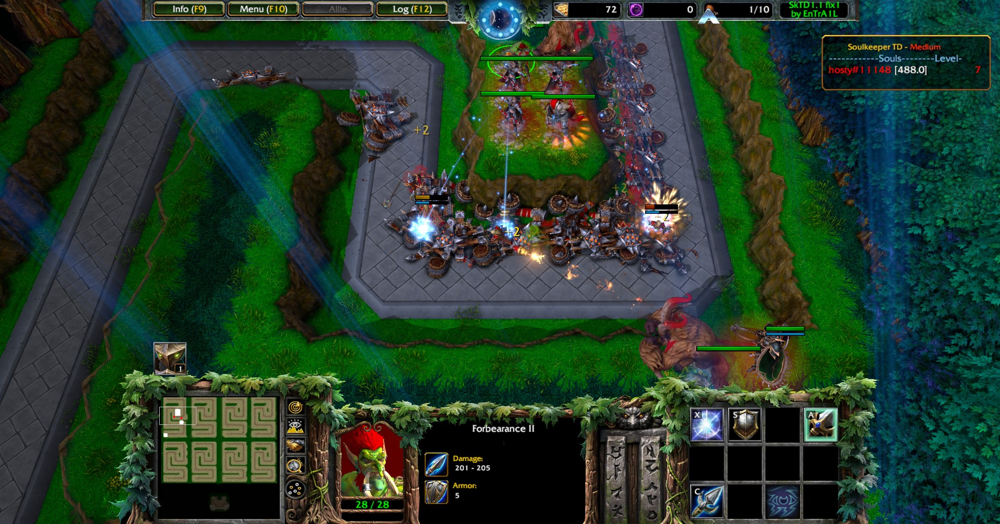
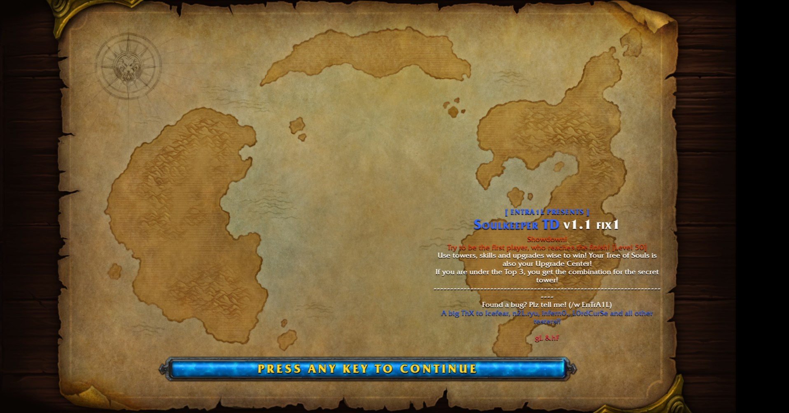
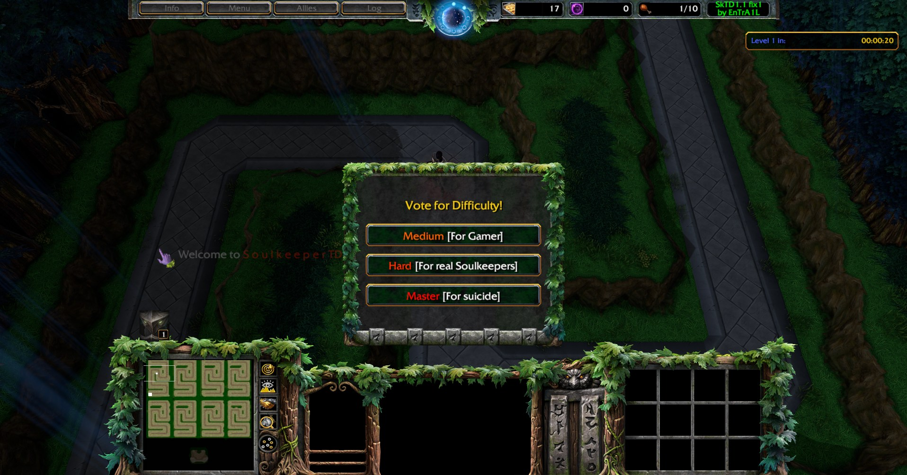

# Soulkeeper Reforged

Revival of **SoulkeeperTD Showdown 1.1**, a Warcraft III tower defense map by **EnTrA1L**. The map was never updated and stopped working on newer versions of the game. This project makes it run again on Warcraft III 1.27b (Legacy) and Reforged without changing how it plays.



## Status

| Version | Changes | 1.27b | Reforged |
|---|---|---|---|
| fix1 | Compatibility fix (JASS "return bug", closed in patch 1.24). Map rebuilt so it opens in the World Editor. | Tested | Tested |

Technical details in [docs/NOTES.md](docs/NOTES.md).

## Screenshots

| Loading screen | Difficulty vote |
|---|---|
|  |  |

## Layout

- `src/map/`: the unpacked map. `war3map.j` is the script; the rest is map data (terrain, units, strings).
- `tools/`: everything needed to build the `.w3m`.
- `build/`: built maps (not versioned).

## Building

On Linux or WSL:

```
tools/build.sh
```

Output: `build/soulkeeper-td-v11b-fix1.w3m`.

Requirements and pjass checking in [docs/BUILD.md](docs/BUILD.md).

## Editing the map in the World Editor

The editor triggers are empty: all the logic lives in `src/map/war3map.j`. Saving from the editor rewrites the script from those empty triggers and **wipes the map logic**. The editor can be used for terrain or object data, but only the changed data files should be copied back to `src/map/`, never the script.

## Credits

- Original map: **EnTrA1L**. The map texts (author, description, credits, loading screen) are kept as in the original; only the version changes. The map includes a check that verifies the author name and credits, and this project keeps it.

## License

Pending. The original map is EnTrA1L's work and has no published license.
